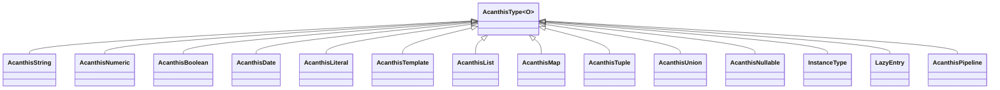

# Current architecture assessment

## Scope and evidence

All 42 Dart files under `lib/` were inspected, including validators, catalogs, registries, and adapters. Existing tests were surveyed across the 45 Dart files under `test/`, with detailed review of composition, diagnostics, presence, specialization, input sharing, rules, live revisions, and registry assertions. Test execution supplies behavioral evidence; no coverage percentage was collected. Benchmark implementations and historical baseline documentation were reviewed. New review probes supplement rather than modify the suite. The [evidence directory](evidence/README.md) records the checkout and measurements.

## Public surface

[`lib/acanthis.dart`](../../lib/acanthis.dart) exports the concrete schema files and `types.dart`, all three exception types, metadata and schema registries, results/formatting, i18n/catalogs, issue codes, live sessions, seeded mocking, audited exporting, and selected-field rules. It hides `AcanthisFieldOperation`, `validationInput`, `singleIssueParameter`, and `readPath`. Operation/check classes and built-in validators are **not** exported by this barrel, although public signatures reference them and existing tests import `src/operations/checks.dart` and `src/validators/...` directly. Their relocation therefore needs compatibility shims, not an assumption that nobody consumes them.

The supported names include top-level primitive factories, `object`, `list`, `tuple`, `union`, `variant`, `literal`, `template`, `lazy`, `instance`, `classSchema`, and equivalent static factories on `AcanthisType`. `AcanthisNumber`, `AcanthisInt`, and `AcanthisDouble` are typedefs for `AcanthisNumeric<num/int/double>`, not separate runtime classes. The fluent API includes checks, same-output transformations, pipelines, metadata, defaults, nullable wrapping, collections, and export/mock methods. Public methods named `parseInternal`, `tryParseInternal`, compiled executor fields, `isPure`, and `operations` are externally accessible extension hooks despite their names. `evaluateObject` is marked `@internal` but remains a public member reachable through the exported class.

## Actual schema hierarchy

The diagram abbreviates type arguments: list output is `List<T>`, map output `Map<String,V>`, tuple output `List<dynamic>`, and nullable/pipeline output `T?`. `ClassSchemaBuilder<I,T>` is a mutable setup builder producing a pipeline; `AcanthisVariant<T>` is a guard/schema pair, not a schema subclass.

`AcanthisType<O>` currently owns configuration, output typing, coercion/recovery hooks, operation compilation, sync and async execution, outcome construction, fluent composition, factories, and integration requirements (`types.dart:87–723`). Subclasses implement copy construction, structural traversal, coercion, export, and mocking. This is a broad responsibility set, but typed leaf execution and compilation are already useful common code. Extraction should target duplicated responsibilities rather than replace the class wholesale.

## Definition and execution lifecycle

1. Fluent methods construct a new schema and append an operation. The base constructor freezes the operation list. Most concrete constructors manually forward async state, key, metadata, default, and coercion settings.
2. The synchronous throwing and collecting operation executors compile lazily on first use (`types.dart:109–299`). Empty operations avoid execution; one ordinary check has a specialized closure; longer sequences form ordered closure chains. These chains execute checks and transformations in declaration order.
3. `parse` rejects schemas marked async, applies null/default handling, then calls virtual `parseInternal`. The base narrows input/coerces it before invoking its compiled executor. `validate` calls the same internal throwing path and converts only `ValidationError` to a message.
4. `tryParse` similarly rejects async schemas, supplies an `IssueSink`, then wraps the returned value as `AcanthisValid` or `AcanthisInvalid`. Base recovery may call `mock(0)`. This dependency becomes problematic for schemas without a mock implementation.
5. Async APIs delegate to sync when `isAsync` is false. Genuinely async schemas iterate operations in order, awaiting async checks. Composite overrides traverse children before running their own operations; `tryParseAsyncOperations` exists specifically to avoid traversing children twice.
6. Collecting behavior consults Zone-local `AcanthisValidationScope`: field operation stopping and object child stopping are independent. Async callbacks are sequential. There is no default parallel executor or asynchronous transformation operation; pipeline mappers are synchronous functions even when input/output validation is async.

See [the findings](architectural-findings.md) for places where overrides do not satisfy these intended contracts. In particular, async methods on an otherwise synchronous schema are insufficient to test the genuinely async path.

## Composition and presence

Same-type `transform` is `O Function(O)`; cross-type `pipe<T>` connects `AcanthisType<O>`, `T Function(O)`, and `AcanthisType<T>`. The pipeline currently subclasses `AcanthisType<T?>`, unnecessarily widening successful non-null output. Its mapper is skipped after input failure. Its output default bypasses input validation/mapping and undergoes output validation. This is already covered by presence tests and should be retained.

Objects use a private missing-value sentinel, separate from explicit null. Nullability controls values; `optionals` controls field presence. Missing defaulted fields validate a default even if optional. Invalid supplied values stay invalid although the failure may carry a default recovery value. Nullable explicit-null defaults have a dedicated presence flag. `partial`/`patch` preserve omission, including defaulted fields; deep partial recurses only through directly nested maps. These are established behaviors in `test/presence_contract_test.dart`, not proposed redesigns.

Unions partition guarded variants and ordinary types, testing guards first, then plain alternatives in declaration order. A successful branch discards previous branch issues; complete failure retains ordered branch diagnostics. Union output has an explicitly selected common type `T`, not a Dart union type. Tuples use a heterogeneous list and optionally repeat the last schema. Lazy entries resolve relative to an object parent; they are not a general standalone deferred-schema facility. Instance field schemas validate getter values and return the original object, discarding child transformed values intentionally. Class mapping uses the pipeline to construct a new domain instance.

## Object execution

`map.dart` has 1,971 lines in this checkout. It combines definitions, cached field arrays, missing/default logic, unknown keys, dependencies, selected rules, full/live evaluation, specialized plans, fluent derivation, both exporters, mocks, and `LazyEntry`.

There are several deliberate execution paths:

| Path | Eligibility and behavior |
| --- | --- |
| `_ObjectTypePlan` (`map.dart:68–161`, `1778–1824`) | Exact built-in `AcanthisMap<dynamic>` and primitive runtime types, pure synchronous schemas, no own operations/dependencies/optional fields; nested plans also require unchanged nested key shape. Accepts only the fast valid case; otherwise falls back. |
| Pure traversal (`733`, `888`) | Checks children, allocates only on changed output, strips extras, preserves identity/order where contract allows; reuses a child sink during collection. |
| General traversal | Builds typed output, handles defaults/coercion/transforms, validates typed passthrough, runs legacy dependencies and own operations. |
| `evaluateObject`/`evaluateObjectAsync` (`355`, `450`) | Cache-aware traversal for selected rules and live sessions; also used for object-first collection. Rules see parsed prerequisites and submitted presence. |
| Async traversal (`1032`, `1132`) | Sequential child awaits, independent diagnostics, then own operations. Synchronous schemas delegate back to sync. |

Unknown-key policies are strip/preserve/reject; typed passthrough validates extra values. Legacy string dependencies read **raw** input through dotted paths; selected rules read **parsed** declared paths. These are different contracts, so replacing one with the other silently would change behavior.

The specialized plan intentionally excludes subclasses; list specialization similarly recognizes exact primitive/check types. Tests force ordinary execution with subclasses and compare validity, values, issues, insertion order, input mutation, and recursive sharing. Preserving those eligibility checks is a correctness requirement, not just a speed concern.

## Diagnostics and outcomes

`AcanthisOutcome<T>` is already sealed, with `AcanthisValid<T>` and `AcanthisInvalid<T>`. Invalid results can have typed recovery or `withoutValue`; accessing `.value` in the latter case throws. A valid result exposes the schema's output type. Default recovery does **not** make an invalid result valid.

`AcanthisIssue` preserves string/int path segments, code, message fallback, frozen JSON-safe parameters, and union branches. Prefixing shares immutable path tails and frozen parameters. Parameter traversal has cycle, depth, node, and collection bounds. Formatting/localization happens at presentation time, including versioned transport without messages. These are substantial existing strengths.

`IssueSink` is an ordered native accumulator with a `Map<String,dynamic>` compatibility interface. Map reads materialize a lossy legacy tree, but `AcanthisOutcome.errors` returns an `IssueSink` and native sink merges copy its native issues directly. Therefore `errors.addAll(result.errors)` does **not** by itself lose duplicate codes, integer paths, parameters, or branches. This was verified with pipeline, tuple, and genuinely async nullable probes and is already tested in `structured_issues_test.dart`. Repeated legacy reads can still allocate projections and deserve measurement before cleanup.

## Integrations and state

| Integration | Current design and implications |
| --- | --- |
| Audited export (`schema_export.dart`) | Independent extension and per-call `_ContractExporter`, input/output modes, checked constraint subset, deterministic local recursion references, depth limit, unsupported-behavior exceptions. This already avoids an AST and global recursion state. Custom subclasses require a stronger trust boundary; see F12. |
| Legacy export | Per-schema best-effort conversion; separate JSON/OpenAPI implementations. Recursive object export uses singleton `LazyObjectMapper`, unlike the audited exporter. Preserve this legacy/audited distinction. |
| Mocking | Legacy `mock` sits on every schema and is also used for base recovery. `mockSeeded` is a bounded independent adapter with exact runtime allowlists, callback rejection, and candidate revalidation; selected rules are a missed rejection case. |
| Metadata | `metadataEntry` is schema-local; `meta` also mutates a singleton `MetadataRegistry`. Entry collections are not deeply frozen. Instance metadata keys derive from `T`, so unrelated schemas for the same type can overwrite registry entries. |
| Schema registry | Explicitly owned immutable binding snapshot with canonical tokens, concrete schema typing, runtime checks after widening, atomic module imports, and no parsing/export/mocking during registration. This is a good integration boundary; do not replace it with the global metadata registry. |
| Live validation | Sessions own mutable input, field/rule caches, dirty top-level fields, issue deltas, and revision state. Input snapshots are copied/frozen; domain objects remain opaque. Async sessions capture input and scope, debounce, cooperatively cancel, and suppress stale publication. |

Live scheduling conservatively invalidates a whole top-level field for nested edits and rules that read that top-level field. Arbitrary object operations, legacy dependencies, and object-first collection trigger full validation. A rule dependency declaration is not permission to cache opaque callbacks that depend on time or hidden external mutable state. Context changes invalidate all caches. Full-validation parity and callback suppression are already tested extensively.

## Extension change surface

| Scenario | Changes needed today | Concrete limitation |
| --- | --- | --- |
| New primitive | Subclass `AcanthisType`, implement mock/export/copy hooks; optional barrel/factory additions for a built-in | Basic runtime extension is possible without editing the compiler; audited export and seeded mock require separate recognition. |
| New composite | Above plus override structural sync/async entry points and internal hooks | More duplicated traversal and recovery rules; `withoutValue` handling is not consistently supported. |
| Custom check | Implement `AcanthisCheck<O>` or use `refine`; import operation file directly | Existing check forms work. An arbitrary new `AcanthisOperation` subclass is silently ignored by compiler/async switch defaults. |
| Transformation | `transform` or `pipe` with a typed mapper | Same-type transforms work; pipeline downstream fluent contract is incomplete; async mappers have no dedicated support. |
| Exporter | Add independent extension/service; audited built-in support changes `_ContractExporter` and `_constraints` | Legacy export remains mandatory on custom schema classes; no generic safe custom export capability today. |
| Mock strategy | Independent extension/service; legacy `mock` override; bounded subset updates `_Generator.check/generate` | Recovery must not require the generator; exact generic runtime allowlists limit support deliberately. |
| Incremental behavior | Map rules with declared inputs/outputs need no scheduler edits; new object-like composite needs live/session/evaluator changes | Live API is map-specific. Generalizing it is optional until a concrete non-map use case exists. |

The main maintainability improvements are outcome-aware composition, immutable definitions and reliable copying, shared semantic primitives across executors, and separation of optional capabilities. Smaller files alone are not an acceptance criterion.
