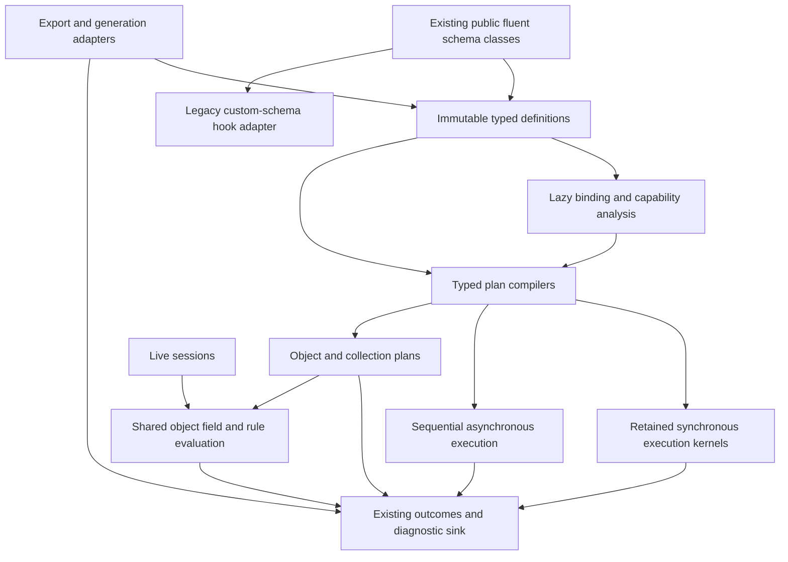

# Complete internal redesign with API and execution continuity

## Assessment

**Follow-up base design:** see [Zod, ArkType and `Schema<I,O>`](zod-arktype-schema-contract.md) for the subsequently requested extensible base, researched execution contracts, compiler checks, and compatibility choices. It refines this document's public schema and composition boundaries without replacing the retained execution kernels.

The follow-up constraint changes the rewrite option substantially: **rebuild the internals while retaining the fluent API and proven execution paths**. This is a credible architectural strategy. It avoids discarding the library's strongest runtime work while allowing configuration, composition, and execution ownership to be designed coherently.

The architectural scope can be comprehensive while implementation and release remain incremental. A single replacement commit would make equivalence and rollback harder to establish. This document evaluates the alternative; it does not implement the rewrite or claim it is already cheaper, faster, or more maintainable than the [incremental roadmap](migration-roadmap.md).

The strongest candidate is a rewrite of **definition ownership and orchestration around retained execution kernels**. Rewriting every validator, diagnostic class, and optimization solely to make all code new would add risk without addressing a demonstrated problem.

## What stays and what is rebuilt

| Area | Preserve | Rebuild or correct |
| --- | --- | --- |
| Public schemas | Factory names, fluent names, concrete schema identities, established generic signatures, supported subclassing | Internal state ownership, copying, delegation, capability checks |
| Operation execution | Typed synchronous closure compilation, empty/one-check shortcuts, declaration order | Input preparation, shape preconditions, exception boundaries, mode consistency |
| Object/list fast paths | Exact-built-in eligibility, specialized type plans, copy-on-change and identity reuse | Immutable definition source, plan ownership, general traversal coordination |
| Diagnostics/results | Existing issues/outcomes, native sink bridge, immutable path sharing, localization/transport | Absence-aware recovery propagation and boundary finishing |
| Composition | Established list/union/tuple/nullable behavior where correct | Pipeline contracts, lazy binding, typed assembly, async capability propagation |
| Rules/live | Declared prerequisites, conservative invalidation, revision snapshots and stale-result suppression | Shared field/rule evaluation boundaries and true throwing fail-fast behavior |
| Integrations | Owned registry contracts, audited input/output exports, bounded generator budgets | Dependency direction, opaque-schema trust, explicit unsupported capabilities |

“Proven” applies to an algorithm **together with its eligibility and observable behavior**, not just its inner loop. For example, transplanting `_ObjectTypePlan.accepts` while broadening eligibility to custom subclasses would not preserve the existing optimization contract. Retain a kernel only for inputs whose assumptions remain established by the new definition model.

Known defects are explicit corrections, not compatibility requirements. Their reduced examples remain in [the findings](architectural-findings.md) and [runtime evidence](evidence/runtime-probes.md).

## Compatibility must have an explicit perimeter

Keeping `.min().nullable().list().parse()` working is necessary, but insufficient. The preservation contract should include:

- Top-level and static factories, constructors, named parameters, concrete public classes, generic output types, fluent return types, and exported symbols.
- Ordinary parse/tryParse/async/validate behavior; defaults, omission, nullable values, PATCH and unknown-key policy.
- Ordered native diagnostics, branch metadata, integer versus string paths, and the lossy legacy map projection.
- Custom schema hooks (`parseInternal`, `tryParseInternal`, coercion and recovery), extensible checks, and supported direct import paths.
- Callback order and count, exceptions, sequential async scheduling, and early stopping.
- Container identity, insertion order, input mutation guarantees, and read-only container behavior.
- Metadata/registry identity, recursive export behavior, and live session state ownership.

Do not make public classes `final`, replace schema instances with generic proxies, or silently remove public internal-looking hooks. Those would break existing extension behavior and may disable exact-type optimizations. Retain public constructor signatures initially; reject incorrectly configured schemas explicitly where the review demonstrated an unsafe contract.

A compatibility ledger should classify each observable difference as **preserved**, **corrected defect**, or **deferred breaking change**, with its test and finding reference. Exact nonnullable pipeline output, removal of failed-outcome `.value`, and a validation-only public base are deferred breaking choices. They do not need to be bundled into the rewrite.

## Proposed implementation model

This is a responsibility diagram. The [existing proposed library layout](proposed-architecture.md#dependency-structure) still applies: base static factories and concrete implementations can share one Dart library with parts, and optional integrations depend outward on schemas. It does not require an extra public schema hierarchy or a universal runtime AST.

### Public schemas own an immutable definition and lazy execution state

Keep concrete classes such as `AcanthisString`, `AcanthisMap<V>`, and `AcanthisList<T>`. Their fluent methods derive a new definition using typed family-local copying; they do not each reconstruct execution semantics. Mutable setup builders remain setup tools whose built schemas snapshot configuration.

A definition is family-specific: leaf coercion and ordered operations, object fields/presence/policies/rules, tuple elements/variadic setting, or pipeline input/mapper/output. Do not unify them into an untyped property dictionary. Share immutable portions when deriving metadata or operations, but measure construction before introducing a configuration object for every intermediate primitive schema.

Definitions contain schema information, not per-input state. Compiled closures and object plans are lazy immutable caches. Diagnostics, input buffers, rule execution state, and live revisions belong to calls or sessions. Callback-captured state and arbitrary domain/default objects remain governed by documented ownership; shallow schema immutability cannot freeze them.

### Plan compilation selects existing execution techniques

Compilation derives only the execution facilities that a schema uses. A leaf can retain its current typed `O Function(O)` operation executor and a separate collector. An eligible object retains its specialized acceptance plan. General composites have outcome-aware collection; genuinely async schemas have sequential async traversal. There is no requirement to wrap every schema in a new `CompiledSchema` object or to compile four unused closures eagerly.

A thin public schema does not imply an additional wrapper allocation or virtual dispatch at every leaf. Keep direct typed closures and batch-resolved leaf executors where they are already effective. If a prototype introduces a delegation object, measure its construction and warmed call costs before making it universal.

The shared contract governs preparation, preconditions, operation order, collection and finishing. It need not produce one physical executor. Sync parsing stays synchronous. Throwing execution stays genuinely fail-fast, including objects with selected rules.

### Composition uses existing outcomes without fabricating values

The new composition implementation must handle `AcanthisInvalid.withoutValue` explicitly. Input failure gates mapping; child failure merges diagnostics; compatible typed recovery is retained only when available. A parent that cannot assemble a complete typed recovery returns invalid without recovery. It never creates arbitrary DTOs through mocks or inserts null into nonnullable lists.

Use existing `AcanthisOutcome<T>` at outcome-aware boundaries. The implementation may still employ allocation-efficient typed child loops for recognized built-ins; it need not allocate an outcome for every successful primitive field. Avoid introducing a parallel failure/issue representation simply to make compiler internals uniform.

The compatibility adapter honors old subclass hooks. Built-ins can migrate to the new collection contract without forcing every consumer subclass to implement new abstract members. Exact built-in optimizations must not route custom hooks around that adapter.

### Lazy binding becomes definition work

Bind parent-dependent lazy references into a stable schema relationship while retaining wrapper operations. Derive/check async capability before sync execution can omit an async check. Recursive capability analysis requires cycle handling; resolution cannot simply ask the parent for its flag recursively forever.

This is the highest-risk design prototype, alongside recovery composition. Evaluate the graph-based and explicit-declaration alternatives in [ADR 006](decisions/006-lazy-binding.md). Preserve stable recursive identity for the audited exporter. Do not make a general standalone lazy feature a prerequisite for correcting the existing parent-bound API.

### Optional services depend on definitions and established diagnostics

Exporters inspect trusted supported definitions and reject opaque behavior. Generators use their bounded supported subset and cannot serve as fallback constructors for validation. Live sessions consume shared object field/rule evaluation while owning invalidation and revision state. Schema registration retains its existing typed token and owned snapshot model.

A typed definition is not automatically an audited JSON contract. Custom schema or predicate subclasses can override semantics; exact built-in recognition or an explicitly trusted adapter is still required. Likewise, a universal visitor or registry is unnecessary merely because the internal implementation is new.

## How this differs from the original incremental plan

| Decision | Original incremental refactor | Comprehensive internal rewrite |
| --- | --- | --- |
| Starting point | Repair current classes, then extract responsibilities | Design the definition/compilation/composition contracts first, then migrate classes onto them |
| Replacement scope | Change components where a concrete defect/coupling requires it | Replace orchestration across all schema families to establish consistent ownership |
| Existing kernels | Retained within current implementation until extracted | Transplanted with their eligibility checks and equivalence tests |
| Compatibility | Natural continuity, with some legacy coupling retained longer | Explicit facade/hook compatibility effort throughout |
| Delivery | Small fixes followed by structural changes | Small vertical migrations toward a fully specified replacement architecture |
| Main risk | Partial cleanup leaves inconsistent boundaries | New infrastructure adds cost or recreates complexity behind the same API |

The rewrite provides a coherent destination sooner. It also demands more up-front design, compatibility fixtures and integration work. Many useful components should end up unchanged; forcing their replacement would not make the result more architecturally complete.

## Feasibility gates before selecting the strategy

Evaluate three vertical prototypes during a later implementation phase:

1. **Primitive chain:** an integer/string schema with coercion, default, metadata, ordered checks/transforms and an actual async refinement. Preserve fluent typing and custom hooks, and retain empty/one-check execution.
2. **Composite failure:** a typed instance/union inside an object/list, including failure without recovery, a selected rule and a pipeline. Demonstrate correct stage gating, field/object stopping and diagnostics without unchecked output casts.
3. **Recursive and specialized object:** stable parent-bound lazy recursion with async descendants, plus a specialization-eligible nested object and a custom subclass forcing ordinary traversal. Demonstrate capability analysis, identity, live/full parity and exact fallback eligibility.

These prototypes exercise the architectural difficulties; a faster plain string parser alone would not validate the rewrite. Keep them private/experimental until the contracts hold. Do not start a second public `v2` API or publish duplicate classes just to run the comparison.

Choose the rewrite only if the prototypes demonstrate:

- A configuration change has one typed owner and reliable propagation rather than repeated forwarding edits.
- A new primitive/composite can implement its own definition/evaluation without editing unrelated schemas. Optional integration support may still need adapter-specific additions.
- All unchanged semantic cases match current outputs, diagnostics, callback behavior and sharing; documented defects pass their corrected contract tests.
- External hook fixtures compile and execute, with no hidden async bypass or fabricated recovery.
- Relevant JIT/AOT construction, first-use and warmed measurements reveal no unexplained material regression. Retain raw samples and variability; the existing provisional baselines are references, not a speed target.
- The same library can support the compatibility facade without a growing collection of per-schema exceptions or dynamic casts.

If those gates fail, revise the new contracts or retain the incremental approach. A cleaner diagram is insufficient evidence to choose the rewrite.

## Delivery if the rewrite is selected

| Stage | Deliverable and release boundary | Gate / rollback |
| --- | --- | --- |
| 0 | Freeze API/behavior ledger, current source snapshot and measurements; add missing contract/compiler fixtures | Existing suite plus corrected-defect tests identified separately; no runtime change |
| 1 | Introduce typed definition ownership and transplant primitive operation compilation | Primitive, construction and custom-hook parity; revert one family independently |
| 2 | Introduce outcome-aware composite traversal and checked typed assembly | Nested absent-recovery matrix, ordered diagnostics and sharing parity |
| 3 | Complete pipeline and bound lazy implementations | Recursive async capability and output stage contracts verified; legacy signatures preserved |
| 4 | Transplant object specialization and general rule/dependency orchestration onto frozen definitions | Fast/ordinary differential corpus, actual fail-fast, JIT/AOT comparisons |
| 5 | Connect live evaluation, audited export, bounded mocks and registries | Full/incremental parity, stale-result suppression, independent export validation, callback rejection |
| 6 | Remove superseded private orchestration and temporary comparison scaffolding; retain required public import/hook adapters | Full suite/type fixtures/examples, dependency graph checks, no two permanent engines |

Do not leave a permanent production engine selector or dual schema representation. During migration, use private test/build separation or a source snapshot to compare implementations. Never execute both validators against a user's input in production: callbacks can have effects, and doubling execution changes the contract.

The old implementation is an oracle only for preserved behavior. Known validation omissions cannot be copied into the replacement to achieve apparent parity. Record every divergence against a correction in the ledger. Keep code moves, semantic fixes and public type changes reviewable separately even when they belong to the same overall redesign.

## Recommendation under the follow-up constraint

**Designing a complete internal rewrite while preserving the API and execution kernels is reasonable.** It addresses the review's strongest maintainability concern: the distribution of responsibility across schemas, copies and execution modes. The appropriate unit of replacement is orchestration and definition ownership, with the existing runtime techniques retained where their assumptions still hold.

The immediate next step would be a compatibility ledger and the three feasibility prototypes—not rewriting every file. That is sufficient to decide whether the comprehensive destination justifies its implementation cost. No source implementation, new dependency, or performance claim is introduced by this proposal.
