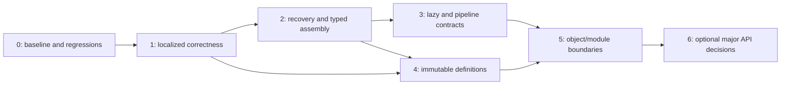

# Incremental refactoring roadmap

## Sequencing and implementation rules

This document is an executable plan, not authorization to implement it during the review. No refactor has been applied. Effort is relative for a small Dart library team: S = a localized patch, M = several related changes, L = cross-composite/API work. Estimates are not delivery promises.

Fixes can land individually; phases describe dependencies, not one giant PR each. Do not combine operation semantics changes, schema library moves, and public generic changes in a single patch. Before editing, inspect the current dirty tree and refresh the [fingerprint/baseline](evidence/README.md); this review is not an instruction to revert pre-existing work.

## Phase 0 — Preserve the baseline and reduce each counterexample

**Scope/files:** read the review, existing tests and benchmarks; prepare reduced regressions in `test/types/composition_regression_test.dart`, `regressions_test.dart`, `instance_failure_test.dart`, `template_test.dart`, `pipe_test.dart`, `selected_field_rules_test.dart`, `seeded_mock_test.dart`, `schema_export_audit_test.dart`; add a type-fixture runner alongside `tool/check_schema_registry_types.dart` if needed.

**Expected improvement:** each correctness patch has a reproducible failure and explicit desired semantics. This is the prerequisite for implementation, not a redesign.

**Public API impact:** none. Record existing behavior separately from intended corrections: literal/template preconditions, callback exceptions, rule fail-fast, lazy async handling, and no-recovery propagation. Do not bless a defect by updating a golden fixture alone.

**Testing:** reproduce F01–F13 counterexamples; add missing combinations described in the testing plan. Existing full suite must remain green; commit a failing regression together with its fix, or keep it in a review harness until then. Run analyzer, suite, negative registry fixtures, 2,000-case differential corpus. Arrange optional Python export validators in the verification environment; this review could not execute that independent validation.

**Performance:** archive a fresh source fingerprint and raw JIT/AOT lifecycle results before edits. Record CPU/power/idle conditions for comparisons; review timings are provisional. Allocate profiling setup is a separate task; unavailable allocation totals must stay unavailable.

**Acceptance:** each proposed correction has a reduced fixture, specified output/issue/callback contract, and a named finding. Baseline artifacts identify the actual tree. No unexplained old/new semantic discrepancy remains hidden in snapshots.

**Risk/effort:** low/S–M. **Rollback:** documentation/probe additions are independent; preserve all old baseline samples and never overwrite them as the “new baseline.”

## Phase 1 — Repair local correctness and integration rejection

**Scope/files:** `types/literal.dart`, `template.dart`, `tuple.dart`, `instance.dart`, `union.dart`, `map.dart` copy methods; base `types.dart` exception scopes and numeric return declarations; `seeded_mock.dart`, `schema_export.dart`, legacy string mock loop.

Land separate small patches for:

1. Literal/template shape preconditions and exactly-once operations (F01/F02).
2. Tuple variadic, instance references, object/union metadata preservation (F08).
3. Input-only TypeError normalization and explicit callback exception policy (F09).
4. `AcanthisNumeric<T>` predicate return types (F13, source-compatible improvement where verified).
5. Reject selected rules before seeded generation and opaque custom schemas before audited export (F11/F12); bound legacy mock loops separately.

**Expected improvement:** stops skipped validation and silent configuration loss with minimal architectural churn. Integration trust becomes explicit.

**Public API impact:** existing names retained. Corrected invalid cases may now reject/throw a programming error instead of appearing valid. Some exports/mocks previously accepted become descriptive unsupported failures. Numeric return tightening improves precision but must be checked against downstream overrides and assignments. No pipeline superclass change here.

**Testing:** all four methods, validate variants, nested placement, wrong types, failing checks, changing transforms and genuinely async operations; copy matrix; callback exception tests; compile-positive numeric chains; opaque callbacks never executed by rejected generator/export paths. Run independent export audit when validators are available.

**Performance:** preserve empty/one-check compiler paths. Measure affected primitive/composite calls, definition construction, and generation limits; semantic fixes need not be performance-neutral but any cost must be isolated and reported.

**Acceptance:** each reduced failure becomes a passing intended-contract test; current 583-test suite and type fixtures still pass. Literal rejecting refinement never succeeds; async template mismatch never succeeds; tuple/refs/metadata survive copies. Wrong input produces diagnostics; unrelated callback type errors are not mislabeled.

**Risk/effort:** medium/M as several independent S patches. **Rollback/compatibility:** revert an individual patch if unrelated behavior regresses, retaining its reduced test on the working branch until resolved. Release notes explicitly enumerate corrections; do not provide a “skip validation” compatibility switch.

## Phase 2 — Make recovery absence composable and typed assembly checked

**Scope/files:** `results.dart`, `issue_sink.dart`, base `types.dart`; `instance.dart`, `union.dart`, `list.dart`, `tuple.dart`, `nullable.dart`, `map.dart`; tests for outcome composition and typed-map construction.

**Expected improvement:** every collecting entry point can produce diagnostics without constructing an arbitrary `O`. Successful typed maps prove the stated value type before exposing it. This removes mocking from validation's internal failure obligation (F04/F05).

**Public API impact:** retain `AcanthisOutcome<T>`, valid/invalid names and `.value`. Preserve existing compatible recovery values. Additional nested invalid cases now return invalid outcomes rather than incidental `StateError`/`UnimplementedError`; invalid parents may explicitly lack recovery. Legacy custom `tryParseInternal` hooks returning `O` remain supported by a narrow fallback adapter. For homogeneous maps, initially check constructor schema compatibility at runtime if static parameter tightening would break legitimate source code; invalid schema configuration gets a setup error.

**Implementation:** introduce only the internal outcome-aware hook/dispatcher needed by built-ins. Never use unchecked casts, mocked DTOs, null-filled nonnullable lists, or shifted tuple positions to satisfy the old hook. Migrate one composite at a time; maintain synchronous throwing execution separately. Parent assembly may retain typed recovery only when all necessary child recoveries are available. Continue independent collection without reading absent values.

**Testing:** nested no-value matrix across object/list/tuple/nullable/union/pipeline/live, defaults, typed generic children, typed passthrough, all/first policy, branch order, callback counts, and third-party schemas overriding legacy hooks. Compile-negative homogeneous map example plus positive `num`/subtype cases.

**Performance:** retain specialized valid traversal without per-field outcome allocation. Measure general invalid-heavy composites and async traversal separately; existing sink reuse and immutable prefixes remain. Typed-map safety must not accidentally remove identity/lazy-view behavior for valid compatible maps.

**Acceptance:** all built-in collecting APIs return a typed invalid outcome for ordinary invalid input, including absent-recovery descendants; callback programming failures still propagate according to contract. No validation path invokes legacy `mock` merely to fabricate recovery. No `AcanthisValid<Map<String,int>>` is produced with a string child. Differential issues/values/sharing match unchanged cases.

**Risk/effort:** high/L. **Rollback/compatibility:** keep legacy hook adaptation until custom-schema fixtures pass; migrate per family so a faulty new dispatcher path can be reverted without replacing the compiler. Do not remove failure `.value` or globally widen output types to unblock a patch.

## Phase 3 — Complete lazy binding and the existing pipeline contract

**Scope/files:** `LazyEntry` in `map.dart`, object child resolution and async eligibility; `AcanthisPipeline` in `types.dart`, `class_schema.dart`, adapters and composition tests. Depends on phase 2 for absent typed output.

**Expected improvement:** exposed schema operations execute consistently; deferred schemas cannot quietly bypass async refinements; pipeline fluent methods work or describe unsupported capabilities (F03/F06).

**Public API impact:** preserve legacy parent-dependent `lazy` and `.pipe` names and legacy `T?` pipeline typing initially. Complete checks/transforms/metadata without an unimplemented runtime hole. Opaque export/mocking uses an explicit capability exception. Bind/validate lazy eligibility before synchronous execution; callbacks returning unexpected async schemas must produce a clear setup/async restriction error rather than acceptance. Additional standalone lazy functionality is out of scope.

**Implementation:** bound resolver retains wrapper operations; protect recursive construction and stable identities. Choose graph-based async capability propagation versus explicit async declaration after a prototype handles recursive parents; document the chosen compatibility behavior in ADR 006. Implement pipeline stage/default/output-operation order specified in the proposal, with immutable copies and async flags. Preserve mapper error behavior deliberately.

**Testing:** lazy operations exactly once, hidden async descendants, direct/mutual recursion, parent validation, recursive export; pipeline stage failures/defaults/checks/transforms/metadata, async input/output/both, builder snapshot, nested lists/maps/unions, and absent output recovery. Add compile-positive composition fixtures for legacy nullable output.

**Performance:** measure binding/construction, first use, warmed recursion, pipelines, and real async scheduling. Cache only definition-derived state; never cache per-input parse results. Keep schema callbacks out of warm eligibility queries where possible.

**Acceptance:** no exposed pipeline validation/fluent method throws `UnimplementedError`; sync execution never ignores an async descendant; no attached lazy operation is discarded. Mappers execute once only after valid input and never on output-default branches. Stable recursive schemas still parse/export and unrelated custom hooks remain invoked.

**Risk/effort:** high/L. **Rollback/compatibility:** preserve the old lazy resolver signature and legacy pipeline facade while new binding/evaluation is internal. Reject unsupported configurations clearly rather than restoring silent omission. Any exact-output public API remains a separate phase 6 decision.

## Phase 4 — Freeze definitions and consolidate family-local copies

**Scope/files:** object/tuple constructors, enum and membership check constructors, metadata value ownership, all schema copy methods; optional private `ObjectDefinition` and typed default-setting helpers.

**Expected improvement:** schemas and their cached plans describe the same definition for their lifetime (F07); changes to configuration affect one family's copy helper rather than every fluent method (F08).

**Public API impact:** retain getters and names but stop caller mutations from changing built definitions. Document shallow snapshot behavior and mutable callback/domain-object/default ownership. Parsed input identity and mutability remain their established contracts. Metadata singleton registration behavior stays compatible unless separately deprecated.

**Testing:** mutate original configuration containers before/after first parse; compare validation/export/async capability; test every derivation preserving unrelated settings. Re-run input reuse, diagnostic reuse, subclass customization, presence, registry identity, and builder snapshot tests.

**Performance:** O(n) snapshot work belongs to construction, not every validation call. Share frozen object definitions where copies need only different operations/metadata. Measure intermediate fluent construction before introducing a new config object in every primitive.

**Acceptance:** no publicly observable definition container can invalidate cached keys/types/isAsync/pattern/plan after construction. Every copy-matrix case passes. Validated input sharing and ordinary path eligibility remain identical except intentional rejected setup cases.

**Risk/effort:** medium/M. **Rollback/compatibility:** land family by family with old constructor signatures where possible. Revert allocation-heavy sharing designs independently of mandatory snapshots; do not reintroduce caller alias mutation to recover a few construction nanoseconds.

## Phase 5 — Extract object semantics and establish acyclic module boundaries

**Scope/files:** object helpers/plans/traversal, operation compilers, rules/path/scope imports, results/sink/i18n contracts, public barrel and compatibility shims. Only after phases 1–4 stabilize behavior.

**Expected improvement:** one owner for presence, dependency reading, eligibility, diagnostics and finishing; smaller change surface for object features and optional integrations (F10/F14/F15). Retain specialized and general executors.

**Public API impact:** no names or signatures intentionally changed. Existing `src` imports in tests and known extension paths remain usable through selective exports. Keep public base static factories; use one schema Dart library with parts if eliminating its genuine base/concrete import cycle. Do not create a second public facade class with a different identity.

**Implementation:** first extract pure helpers without moving types. Give rule-enabled throwing execution a real fail-fast path; characterize own operations after child failure and unknown-key ordering separately as semantic corrections. Remove integration imports from execution. Then mechanically reorganize libraries/parts and diagnostic leaf contracts in a separate change. Keep legacy best-effort export implementation within its schema library while audited services depend outward on schemas. Move legacy recursive export state to a per-call context if touched; owned schema registry stays independent.

**Testing:** full/first sync/async equivalence, rules/dependencies/raw-vs-parsed inputs, direct/nested diagnostics, live/full parity, independent locale/context scopes, recursive exporters, custom hooks, package import compatibility and compiler fixtures. Analyze representative direct `src` imports and all public examples.

**Performance:** compiler and plan extraction must preserve lazy construction, single-check/empty fast paths, exact-type eligibility, input sharing, reusable sinks, and tail-sharing issues. Run differential corpus and matched JIT/AOT lifecycle comparisons, including construction/first-use. No generic visitor replaces a hot loop without evidence.

**Acceptance:** target library graph has no import cycles; public barrel is never imported by internal implementation. Object semantic helpers have a single tested contract. Fast and forced-ordinary paths retain issue/value/sharing parity. Unexplained repeatable throughput or construction regression is investigated before landing extraction-only patches.

**Risk/effort:** medium/high/L, split into several mechanical changes. **Rollback/compatibility:** keep old file export shims; separate moves from behavior changes so either can be reverted independently. Do not remove old internal-looking public hooks without a versioned deprecation strategy.

## Phase 6 — Decide optional public API evolution

**Scope/files:** pipeline public output type, optional validation-only/capability interfaces, integration APIs and deprecations; possibly registry tokens/examples affected by pipeline output changes. This phase is **optional**, not required to finish correctness and maintainability work.

**Expected improvement:** successful pipeline output has exact `O` typing; validation-only extensions do not need to pretend they support export or mocking. Requires concrete consumer demand and a compatibility proposal (F06/F13/F15).

**Public API impact:** changing pipeline superclass `AcanthisType<O?>` to `AcanthisType<O>`, removing base members, or removing failure `.value` is breaking. Prefer retaining legacy facades and introducing an explicit exact-output API only if useful before a major release. Do not add package-wide `Schema<I,O>` automatically.

**Testing:** compile representative consumers, nullable pipeline operations/metadata/registry tokens, output inference chains, custom subclasses, direct imports, and migration examples. No newly exposed operation may have an incomplete implementation. Compare supported/unsupported integration behavior explicitly.

**Performance:** static type improvements should not add a universal wrapper/dispatch allocation. Measure any facade/adaptation layer; preserve plan eligibility or document an attributable change.

**Acceptance:** a published migration guide lists every breaking signature and mechanical alternative; positive/negative fixtures validate the actual Dart guarantees. Consumer benefit is demonstrated. No major API change is accepted solely to make implementation shorter.

**Risk/effort:** high/L. **Rollback/compatibility:** defer the entire phase if benefit does not justify breakage; existing corrected legacy APIs remain viable. Stage deprecations before removal and maintain forwarding adapters for at least the chosen compatibility window, which maintainers must decide rather than this review inventing a release schedule.

## Compatibility assessment

| Change | Compatible approach | Potential break / explicit decision |
| --- | --- | --- |
| Skipped literal/template/lazy validation | Preserve names; enforce documented checks | Previously accepted invalid input fails. Release-note correctness correction. |
| Absent recovery in composites | Existing invalid outcome with `hasValue == false`; keep legacy getters/hooks | Clients blindly reading invalid `.value` may now encounter intentional absent recovery instead of incidental validator crashes. Document pattern matching. |
| Typed object construction | Runtime setup check, later typed constructor parameters | Code constructing a generically incompatible schema stops working intentionally. |
| Numeric precision | `AcanthisNumeric<T>` returns | Usually source-compatible narrowing; external overrides and generic assignments need compiler checks. Predicate `.integer()` must not falsely narrow a `num` output. |
| Pipeline completeness | Implement legacy nullable contract and capability exceptions | Exact nonnullable `O` public output is independently breaking. |
| Immutable definitions | Snapshot caller collections, preserve signatures | Code depending on post-build mutation changes behavior; no supported cache consistency can be guaranteed with mutable aliases. |
| Callback error boundaries | Input-only normalization, retain custom-check catch policy | Previously swallowed callback errors now propagate. |
| Opaque export/mock rejection | Existing descriptive exceptions | Wrongly accepted custom subclass exports/rule mocks now reject. |
| Module/library moves | Preserve barrel names, class identities, and old-path export shims | Making classes final/sealed, removing hooks, or eliminating static factories would break extensions; not part of phase 5. |
| Global metadata cleanup | Schema-local canonical entry plus legacy registration facade | Removing singleton lookup needs deprecation and an explicit lifecycle replacement. |

## Prioritized agent implementation checklist

- [ ] Read current `AGENTS.md` if introduced since this review; preserve the existing dirty tree and refresh fingerprints/baseline.
- [ ] Reproduce each executed counterexample from the evidence and prepare intended-contract regressions.
- [ ] Fix F01/F02 individually, with operation/precondition order and wrong-type handling explicit.
- [ ] Repair F08 copies and F09 exception scopes; preserve numeric generic returns (F13).
- [ ] Reject seeded selected rules and opaque audited export subclasses; bound legacy mock loops (F11/F12).
- [ ] Make invalid no-recovery outcomes composable, migrate built-ins without changing legacy extension signatures (F04).
- [ ] Enforce typed object child/passthrough output compatibility before successful results (F05).
- [ ] Bind lazy operations and async capability safely; complete pipeline checks/transforms/metadata/defaults (F03/F06).
- [ ] Snapshot schema definitions and centralize family-local copying; preserve parsed-container ownership (F07/F08).
- [ ] Specify/fix rule-enabled fail-fast and remaining object policy discrepancies, then extract shared object helpers (F10).
- [ ] Reorganize imports/libraries mechanically, preserve shims, keep integrations outside execution (F14/F15).
- [ ] At every gate: analyzer, relevant tests, full suite, type fixtures, differential parity; integration audit when applicable; matched JIT/AOT measurements for execution/configuration changes.
- [ ] Only after correctness/maintenance work, decide whether exact pipeline outputs or validation-only public contracts justify a major/additive API change.

Unresolved decisions are explicit: lazy recursive async capability strategy, own object operations after child failure, pipeline mapper exception detail policy, lifetime of legacy recovery access, and timing/need of a major API release. Resolve each when its phase is implemented; none justifies silently inventing new runtime semantics during a mechanical extraction.
