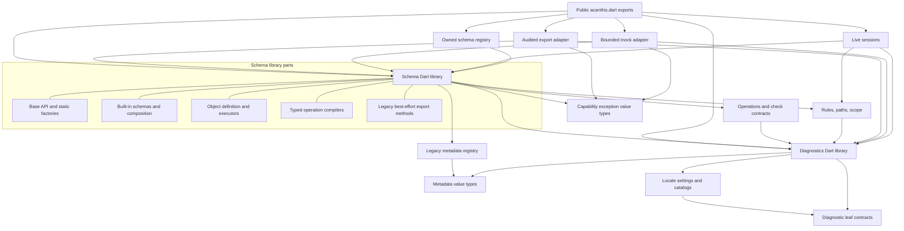

# Proposed internal architecture

## Design direction

Keep the public fluent schema family and the current specialized executors. Refactor around **shared semantic decisions**, **outcome-aware composition**, and **immutable definitions**. The first implementation should mostly correct overrides, normalize configuration copying, and add internal helpers. A single universal executor, new public schema hierarchy, or schema AST would increase migration cost without demonstrated benefit.

This is a target, not an instruction to move every file immediately. [The roadmap](migration-roadmap.md) separates correctness patches from module reorganization and compatibility decisions.

## Contract boundaries

| Boundary | Public contract | Internal contract | Implementation detail |
| --- | --- | --- | --- |
| Schema | `AcanthisType<O>`, concrete families, factories/fluent names | Outcome-aware evaluation and checked input conversion | Cached closures, primitive kinds, plan arrays |
| Definition | Existing getters/constructor parameters retained | Frozen child collections, typed default presence, reliable family-local copies | Sharing immutable definitions across derived schemas |
| Operation | `refine`, `refineAsync`, `transform`; existing custom check classes remain usable | Ordered supported-kind execution; explicit unknown-kind rejection | Single-check shortcut and closure-chain compilation |
| Context | `AcanthisValidationScope`, collection policy, context/cancellation | One immutable options snapshot per evaluation, call-local diagnostics | Zone adapter, optional callbacks for live settlement |
| Result | Existing sealed `AcanthisOutcome`, valid/invalid, issue types | Successful output or invalid with explicit optional recovery | Reused child sinks, lazy legacy projection |
| Composition | List, object, nullable, tuple, union, lazy, pipeline | No mapper on invalid input; no `.value` read on missing recovery | Specialized traversal and bound lazy resolution |
| Integration | Existing export/mock/live/registry APIs | Independent services with explicit unsupported cases | Export recursion maps, generator budgets, session caches |

Do not conflate an invalid value of Dart type `O` with a value satisfying the schema. `AcanthisInvalid<O>` may hold the former; only `AcanthisValid<O>` certifies the latter. Do not allocate a second diagnostic tree to represent that distinction.

## Dependency structure

Arrows point from a consumer to what it depends on. Dashed grouping represents source files within one Dart library, not imports between them.



Execution must not import `acanthis.dart`, live sessions, schema registration, audited export, or seeded generation. The public barrel is a leaf export surface. i18n imports a leaf resolver typedef rather than `results.dart`. Diagnostics and its legacy sink can be parts of one library so `outcome.errors` retains its native sink bridge without a results↔sink import cycle.

**A real compatibility complication:** `AcanthisType` static factories reference concrete subclasses, which inherit from `AcanthisType`. Retaining those static names while making each a separate importing library cannot yield a strict acyclic base/concrete import graph. Merely replacing barrel imports does not solve this. For the target graph, keep base and built-ins as parts of **one schema Dart library**. This preserves one public class identity and permits private implementation files for object plans without expanding internal APIs. Existing `src/types/*.dart` files become selective export shims when moved. An alternative is to deprecate static factories in a major release and keep only top-level factories; that is more disruptive than the current maintenance problem warrants.

Do not simultaneously consolidate libraries and change semantics. Perform any `part` migration mechanically after regression coverage exists. The broader private namespace and larger library are costs; prefix private helpers by responsibility and avoid using library-wide visibility as permission for arbitrary coupling.

## Proposed directory layout

```text
lib/
  acanthis.dart                         # same public barrel
  src/
    schema.dart                        # library; base + built-ins as parts
    schema/
      base.dart                        # AcanthisType and public fluent API
      config.dart                      # typed default presence, copy helpers
      operation_compiler.dart          # existing sync compiler, moved intact
      primitive/                       # string, numeric, boolean, date, literal, template parts
      composition/                     # list, tuple, nullable, union, pipeline, bound lazy parts
      object/
        definition.dart                # frozen fields, policies, rules, dependencies
        presence.dart                  # missing/default/optional decisions
        sync.dart                      # throwing + collecting loops
        async.dart                     # sequential async traversal
        evaluation.dart                # rule/live cache-aware evaluation
        type_plan.dart                 # existing private specialization
        legacy_export.dart             # legacy methods/helpers during transition
      instance.dart                    # instance field/ref behavior
      class_schema.dart                # setup builder
    diagnostics.dart                   # library; issue/outcome/sink parts
    diagnostics/
      contracts.dart                   # resolver typedef and leaf contracts
      issue.dart
      outcome.dart
      issue_sink.dart                   # preserves legacy Map bridge
    operations/                        # existing extensible checks and transforms
    validators/                        # built-in predicates; remain independent
    rules.dart                         # paths, declared prerequisites, scope
    live.dart                          # revision/session state; can split later if needed
    schema_export.dart                 # existing audited service
    seeded_mock.dart                   # bounded generation service
    exceptions/
      capability_errors.dart           # export/mock exception values, no service imports
    registries/
      metadata_entry.dart              # values independent of registry
      metadata_registry.dart           # compatibility singleton
      schema_registry.dart             # existing owned binding registry
    i18n.dart
    i18n/catalogs.dart
    types/*.dart                       # compatibility exports after moves
    results.dart                       # compatibility exports after move
```

Create only files required by an actual extraction; empty folders and a service class per tiny helper add no value. Existing validators/check import paths should remain usable during transition. Extracting a type plan into a part file preserves its private exact-type gates and does not require a virtual `plan()` method on every schema. Move shared capability exception value types out of service implementations and re-export them at their old paths: for example, list legacy mocking currently imports `seeded_mock.dart` solely for `AcanthisMockException`. The target schema library must import that leaf exception rather than the bounded generator service.

## Validation semantics to make explicit

### Inputs, presence, and defaults

At external entry points, input is unknown (`dynamic` today; `Object?` can express an internal untrusted boundary). Narrow it once to the schema's expected input representation before executing typed operations. This boundary is deliberately broad; typed callbacks/output must stay generic.

Object presence decisions use a sentinel independent of null. Ordinary defaults and nullable explicit-null defaults keep their current semantics. A typed `DefaultSetting<O>` can represent absence with a nullable setting object and explicit `value` of type `O`, including null when `O` is nullable. Avoid an untyped default sentinel throughout primitive executors. Family-local copy helpers are the first step; adding one configuration allocation per fluent step is contingent on construction benchmarks.

Object definitions snapshot child maps, keys, optional sets, rules, and dependencies. Keep operation sequences immutable, including any check constraint collection. Configuration immutability does not imply ownership of output containers: pure parse identity and read-only input behavior remain unchanged. Arbitrary mutable DTOs/default values and callback-captured state require a documented caller contract.

### Shared contract, distinct executors

Keep throwing execution fail-fast, collecting execution policy-controlled, and async execution sequential. Share input preparation, shape preconditions, operation-kind interpretation, issue construction, presence decisions, and default/recovery rules. Do not implement sync parsing by awaiting anything, nor add `FutureOr` checks at every synchronous operation.

Literal equality/template matching are shape preconditions, followed by operations in order. A successful shape-changing transformation is governed by downstream operations/output schema; it need not be revalidated against its earlier input precondition. Characterize and intentionally correct collecting precondition ordering in F01/F02 rather than preserving a contradictory contract accidentally.

Throwing mode returns `O` or a `ValidationError`; collecting mode returns `AcanthisOutcome<O>`. Input conversion errors get validation diagnostics. Same-output callback programming exceptions propagate except for existing custom refinement wrappers' documented exception-to-failure behavior. Pipeline mapper failures retain their explicitly chosen transform-error policy. Partial execution after failure never yields `AcanthisValid`.

Field-first stopping remains distinct from object-first stopping. First-field stopping must be **local** to that field's operations, not triggered by a sibling's sink state. A context can snapshot options once per call; do not add a context/path object per primitive or issue. Preserve immutable path-tail prefixing unless profiling establishes a problem.

### Outcome-aware composition

The internal evaluation boundary must represent failure without `O`. An optional transitional contract can be introduced only when built-in migration requires it:

```dart
abstract interface class OutcomeEvaluator<O> {
  AcanthisOutcome<O> evaluateOutcome(Object? input);
  Future<AcanthisOutcome<O>> evaluateOutcomeAsync(Object? input);
}
```

This is an internal capability, not a new public base hierarchy or a requirement imposed immediately on third-party subclasses. A compatibility dispatcher uses existing hooks for schemas not migrated; migrated built-ins never require `mock` to assemble failures. The actual interface/function choice should be driven by F04 implementation: prefer internal functions if an interface adds only forwarding methods. Do not use dynamic dispatch to reconstruct output types that the schema already knows.

This standalone Dart example demonstrates the stage gate using the **existing** outcomes:

```dart
AcanthisOutcome<O> mapValid<I, O>(
  AcanthisOutcome<I> input,
  O Function(I) mapper,
  AcanthisOutcome<O> Function(O) validateOutput,
) {
  switch (input) {
    case AcanthisValid<I>(:final value):
      return validateOutput(mapper(value));
    case AcanthisInvalid<I>(:final issues):
      return AcanthisInvalid<O>.withoutValue(issues);
  }
}
```

The example isolates typing and gating; production pipelines additionally attach metadata, apply output defaults, retain compatible typed recovery, and normalize mapper exceptions according to their contract. No mapper executes against an invalid recovery value. Composite collectors can continue siblings under `all` but must propagate lack of parent recovery when they cannot construct a complete typed container. Never insert null into a `List<T>` when `T` is non-nullable, shift tuple positions to hide invalid elements, or cast a partial DTO into its promised output.

### Pipelines

The stage order is: prepare presence/default → input validation → mapper exactly once → output validation → pipeline-owned output operations in declaration order. Input failure stops mapper/output execution. Output failure preserves its issues and compatible recovery; any resulting default is recovery only unless it was selected by the established null/omission default path. Default output is validated without input mapping. Async eligibility includes input, output, and output operations. Mappers remain synchronous in this scope.

Complete the legacy `AcanthisPipeline<I,O>` interface first, retaining its public `O?` output temporarily. New successful output typing `AcanthisType<O>` should be introduced in a major release or an explicit additive exact-output API (see [ADR 002](decisions/002-output-types-and-recovery.md)). If legacy nullable output transformations can return null, they remain valid only for that legacy nullable contract; do not claim an internal non-null `O` guarantee for them.

Unsupported export/mock operations use descriptive existing integration exceptions; externally visible schema members must have executable behavior or a documented unsupported capability contract. In the next major API, capability interfaces/extensions can exclude optional integration members from the minimum validation interface. Do not expose newly incomplete methods while making pipeline checks work.

### Objects and live reuse

Separate immutable object definition, private specialization plan, and call/session execution state. Share presence and assembly helpers without routing the fast valid case through outcome allocation per field. Cache eligibility belongs to the plan compiler; primitive subclass exclusions stay exact.

Selected rules read declared **parsed** prerequisites and produce declared issue paths. Legacy dependencies keep reading **raw** inputs and preserve legacy dotted-path semantics. Share their implementation across sync/async loops without changing which data they read. Characterize negatives/out-of-range indices and dotted keys before migrating legacy paths to `AcanthisPath`; such migration is opt-in because literal-dot semantics differ.

Live sessions remain map-specific and own revision caches. Full and incremental evaluation share field/rule finishing semantics. Input snapshots and stale-publication guards stay session concerns; they should not enter pure primitive schemas. Keep top-level conservative invalidation and full fallback for opaque dependencies/operations. A generalized incremental capability is deferred until a second composite has a real use case.

## Alternatives and costs

The following decisions cover substantial changes; [ADRs](decisions/README.md) record rationale and compatibility constraints.

| Change / source problem | Alternative | Recommendation and maintainability/extensibility benefit | Type, runtime, memory, API, complexity |
| --- | --- | --- | --- |
| F01–F03, F09 duplicated semantics | One universal engine or code generation | Shared preparation/shape/finish helpers, separate current loops; fixes can be localized and extension rules become explicit | Typed operation closures stay; helper calls may inline but must be measured. Low-to-medium work; mostly correctness changes, callback exception behavior needs notes. |
| F04 recovery absence | Fabricate mocks; nullable outputs everywhere; remove recovery in a major rewrite | Reuse existing outcomes internally; compatible recovery retained, absence propagated | No unchecked output casts. Extra outcomes on general composite paths may allocate; fast valid paths stay specialized. Medium/high migration because legacy internal hook returns `O`. Public return class unchanged. |
| F07–F08 mutable/copy configuration | Deep-freeze everything; global configuration map; generated copy framework | Shallow snapshots and family-local typed copy helpers, then shared object definition if useful | O(n) construction copies; immutable sharing later amortizes cost. No new dependency. Consumer mutation semantics change deliberately. Medium effort; output identity preserved. |
| F06/F13 pipeline | Remove inheritance and lose fluent composition; silently change nullable output now | Complete existing interface, isolate exact-output typing as a separately versioned decision | Preserves typed mapper and output validator. Some legacy nullable operations cannot satisfy exact output. Medium/high work; major type migration optional. |
| F10 object size/coupling | Replace specialized traversal with generic visitors | Extract private parts/helpers and retain plan/compiler loops | No per-field visitor dispatch required. Construction/call overhead must pass baseline gates. Medium extraction effort with no intended public name change. |
| F11/F12 optional integrations | Universal AST; mandatory visitor on every schema; global plugin registry | Keep independent existing adapters and reject unknown semantics; introduce explicit custom capability only with a supported extension use case | No parsing overhead for integrations. Built-in switches still require adapter-specific additions; this is an honest small-team cost. Static custom adapter closures can retain schema typing. Low/medium initial work; capability removal from base is major. |
| F14 import cycles | Introduce a facade/core inheritance hierarchy; remove static factories | One schema library with parts; diagnostic library with leaf locale contracts | No runtime object/dispatch overhead. Larger private namespace is a maintainability tradeoff; export shims retain paths. Medium mechanical work; no API rename. |
| F15 global metadata/export state | Leave legacy code indefinitely; make all registries global | Schema-local metadata canonical, owned new registries retained, per-call legacy export context when touched | Context allocation only for export. Global lookup callers need a compatibility bridge. Low/medium work, lower priority. |

### Export and mocking extension choice

A mandatory visitor requires each new schema to update/implement visitor cases, plus decisions for unknown schemas and third-party visitors; it is premature for two existing adapters. A universal AST centralizes structure but adds a second schema representation, build allocations, mapping loss, and executor migration obligations. A global registry of untyped callbacks risks order-dependent behavior, runtime casts, and hidden global state.

Independent adapters with explicit unsupported behavior are the best current fit. When a real custom export/mock integration is requested, accept a typed capability or caller-owned typed adapter; convert to any heterogeneous dispatch only in one checked binder. Keep input/output export modes and audited constraints. A schema supporting validation need not promise generation or exact JSON representation. Legacy abstract members remain compatibility requirements until a major version can remove them from the minimal public interface.

### What is deliberately deferred

General async transformations; structural record inference from arbitrary map keys; a non-map incremental engine; an AST/operation bytecode; automatic registry-based discovery; replacement of closure compilation; removal of failed-outcome `.value`; and generalized visitor APIs. None is required to correct the reproduced defects. Performance-sensitive changes need comparative measurements after behavior is aligned, not architectural intuition.
